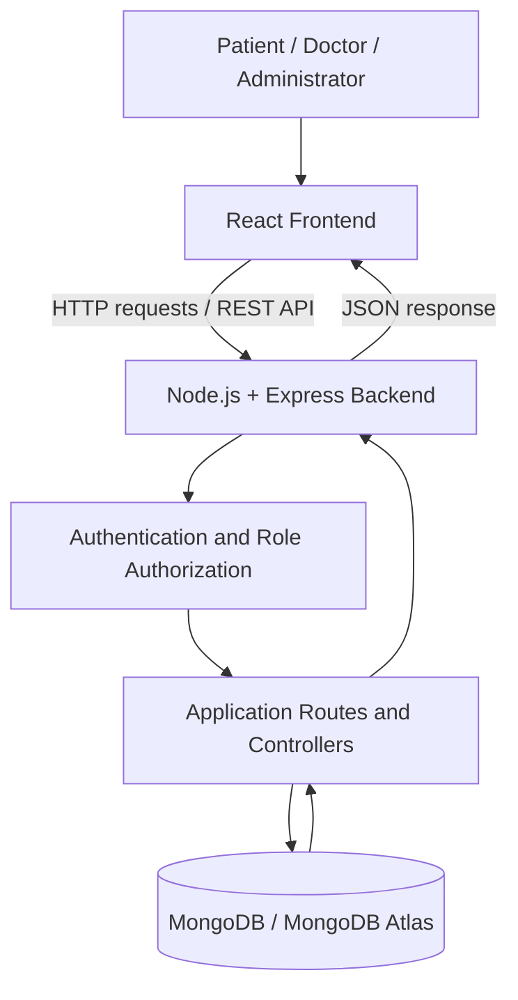

Hospital Management System
A full-stack web application designed to help hospitals manage patient
and doctor workflows, appointments, prescriptions, and administrative
operations through role-based access.
Project status: Update the bracketed placeholders and verify each
feature against the current repository before submitting. Do not leave
placeholder links in the final public README.

Table of Contents
- Team Details
- College / Incubator Information
- Project Overview
- Problem Statement
- Healthcare Use Case
- Objectives
- Key Features
- User Roles
- Technology Stack
- System Architecture
- Application Workflow
- Security
- Project Structure
- Prerequisites
- Installation and Setup
- Environment Variables
- Running the Application
- API Overview
- Database Overview
- Demo Video
- Architecture Diagram
- Project Presentation
- Testing
- Deployment
- Limitations and Future
  Enhancements
- Open-Source License
- Acknowledgements
Team Details
  Field           Details
  Team name       TechTitan
  Team leader     Pankaj Kumar Singh
  Team members    Pankaj Kumar Singh
  Contact email   pankaj03032006@gmail.com
College / Incubator Information
  Field                               Details
  College / Institution               National Institute of Technology Mizoram

  Department                          Computer Science and Engineering

 
Project Overview
Hospital Management System is a web-based application intended to
organize common hospital operations in one place. The application uses a
React frontend, a Node.js and Express backend, and MongoDB for data
storage. It provides role-based access for patients, doctors, and
administrators.

Repository: Hospital Management System on
GitHub
Problem Statement
Hospitals may manage patient information, appointments, doctor
workflows, and prescriptions across disconnected or manual processes.
These approaches can lead to duplicated data, delays in accessing
records, avoidable administrative effort, and difficulty tracking
patient care.

The project aims to provide a centralized web application through which
authorized users can access the functions relevant to their roles, while
authentication and authorization help protect restricted operations.
Healthcare Use Case
The system is intended for a small hospital, clinic, or academic
healthcare-management demonstration.
- Patients can use the patient-facing functions implemented in the
  application, such as accessing relevant records and
  appointment-related workflows.
- Doctors can use doctor-facing functions to manage relevant
  patient and prescription workflows.
- Administrators can use administrative functions to oversee
  system records and operations.
This is an administrative software project, not a diagnostic or
clinical decision-support system. It must not be used with real
patient data unless it has undergone appropriate security, privacy,
clinical, and legal review.

Objectives
- Centralize common hospital-management workflows in a web
  application.
- Separate patient, doctor, and administrator permissions.
- Provide REST API endpoints for communication between frontend and
  backend.
- Store application data in MongoDB.
- Apply authentication and password-protection practices.
- Make the interface reusable and responsive.
Key Features
The repository has been described as including the following
capabilities. Confirm the current implementation and remove any item
that is not present in the submitted version.
- Role-based access for patients, doctors, and administrators.
- User authentication and protected routes.
- JWT-based authentication with refresh-token support.
- Password hashing using bcrypt.
- Patient and doctor workflow management.
- Appointment-related workflows.
- Prescription creation and related prescription workflows.
- Medicine-related data used by prescription workflows.
- REST API communication between the React client and Express server.
- MongoDB / MongoDB Atlas data persistence.
- Reusable React UI components styled with Tailwind CSS.
- Error monitoring integration where configured.
User Roles
  Role                                Purpose
  Patient                             Access patient-facing features and
                                      relevant personal information.

  Doctor                              Access doctor-facing workflows and
                                      relevant patient/prescription
                                      information.

  Administrator                       Manage authorized administrative
                                  functions.
Permissions should be enforced on the backend, not only by hiding
frontend buttons or pages.
Technology Stack
  Layer               Technologies
  Frontend            React.js, JavaScript, HTML, CSS
  Styling / UI        Tailwind CSS; UI libraries used by the current client
  Backend             Node.js, Express.js
  Database            MongoDB, MongoDB Atlas
  Authentication      JSON Web Tokens (JWT), refresh tokens, bcrypt
  API style           REST
  Development tools   Git, GitHub, npm, VS Code
  Monitoring          Sentry, if configured in the submitted environment
  Deployment          Configure according to the actual public deployment
System Architecture
The application follows a client-server architecture. The React client
sends HTTP requests to the Express API. The backend validates the
request, applies authentication and role-based authorization, interacts
with MongoDB, and returns a response to the client.

Architecture Diagram File
The submission checklist requires a separate architecture diagram in PDF
or PPT format.
- Architecture diagram:
  [Add a public link to architecture-diagram.pdf or architecture-diagram.pptx]
Upload the actual file to this repository (for example, in docs/) or
to a publicly accessible location, then replace the placeholder above.
Application Workflow
1. A user opens the React application.
2. The user signs in through the authentication flow.
3. The frontend sends a request to the backend API.
4. Protected backend middleware validates authentication and checks
   permissions.
5. The relevant route/controller reads or updates data in MongoDB.
6. The backend returns a JSON response.
7. The frontend displays the result or an error message.
Security
Security-related measures described for this project include:
- JWT-based authentication and refresh-token support.
- Password hashing with bcrypt.
- Role-based authorization for protected functionality.
- Server-side checks for protected API endpoints.
- Environment variables for secrets and connection strings.
Security notes
- Never commit .env files, database credentials, private keys, real
  access tokens, or patient data.
- Use a strong, unique secret for each deployment environment.
- Configure CORS to allow only the required frontend origins.
- Validate and sanitize incoming data on the server.
- Use HTTPS in production.
- Store and rotate refresh tokens securely; follow the
  implementation's actual token-storage and revocation design.
- Do not include real patient information in screenshots, demo
  recordings, seed data, or public issue reports.
Project Structure
The repository uses separate client and server applications. The exact
filenames may differ from this illustrative layout; update it to match
the submitted repository.
Hospital-Management-System/
├── client/                 # React frontend
│   ├── public/
│   ├── src/
│   │   ├── components/     # Reusable UI components
│   │   ├── pages/          # Application pages
│   │   ├── services/       # API calls, if organized here
│   │   └── ...
│   └── package.json
├── server/                 # Node.js / Express backend
│   ├── routes/             # API routes
│   ├── controllers/        # Request handlers
│   ├── models/             # MongoDB models
│   ├── middleware/         # Authentication / authorization
│   ├── index.js            # Server entry point (verify path)
│   └── package.json
├── docs/                   # Optional: architecture and presentation files
├── .gitignore
└── README.md
Prerequisites
Install the following before running the project:
- Node.js and npm.
- Git.
- A MongoDB instance or MongoDB Atlas connection string.
- A modern web browser.
Check installed versions:
node --version
npm --version
git --version
Installation and Setup
1. Clone the repository
git clone https://github.com/pankaj03032006/Hospital-Management-System.git
cd Hospital-Management-System
2. Install frontend dependencies
cd client
npm install
3. Install backend dependencies
Open a second terminal:
cd server
npm install
4. Configure environment variables
Create the required .env file in the server directory and add the
variables expected by the backend configuration. See Environment
Variables. Do not commit this file.
5. Start the backend and frontend
Use the scripts already defined in each package.json. Typical commands
are shown below; check the scripts in the repository before running
them.

Backend terminal:
cd server
npm run dev
If the backend does not define a dev script, use the script listed in
server/package.json (for example, npm start).

Frontend terminal:
cd client
npm start
If the frontend uses Vite rather than Create React App, the development
command is usually npm run dev. Use the command defined in
client/package.json.

Typical API areas include:

  API area         Purpose
  Authentication   Sign-in, token validation, and refresh flow
  Patients         Patient records and related patient operations
  Doctors          Doctor-facing records and workflows
  Appointments     Appointment-related operations
  Prescriptions    Prescription creation and retrieval
  Medicines        Medicine data used in prescription workflows
  Administration   Authorized administrative operations

For each endpoint, document the actual HTTP method, path, required role,
request body, and response. Do not publish tokens, credentials, or
private patient data in examples.

- Presentation:
 https://docs.google.com/presentation/d/1bPZf1vrmXL7Spm8to5VHcxJ2CxTss3qU/edit?usp=sharing&ouid=115730262100538738897&rtpof=true&sd=true

   - Live application:
     https://synoddurtlang.vercel.app/

